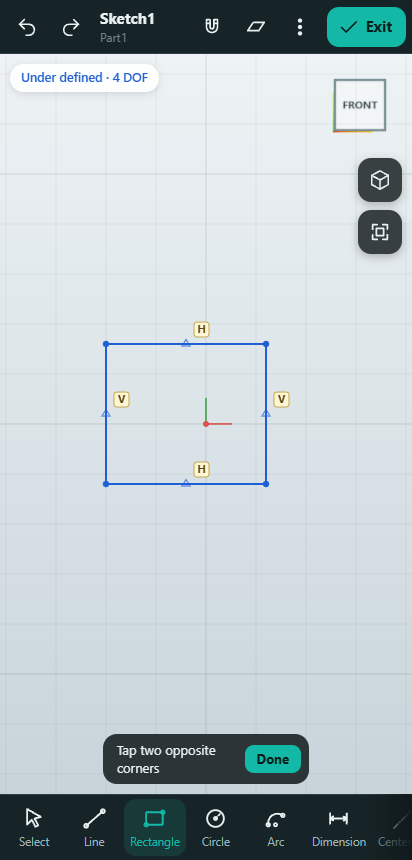
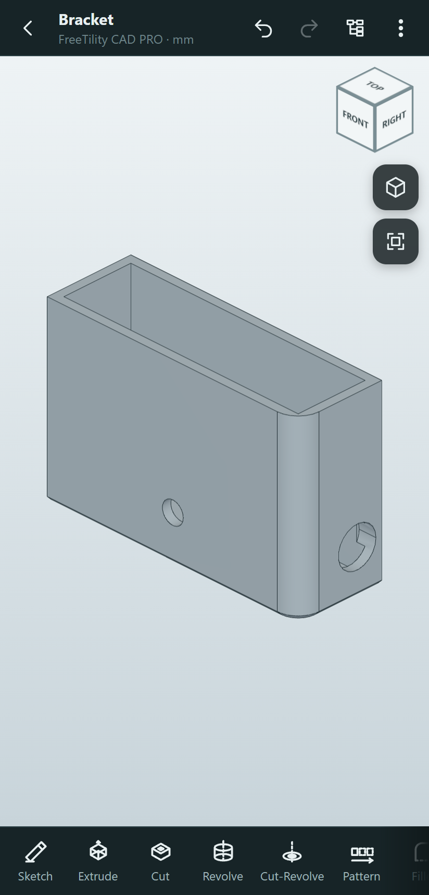
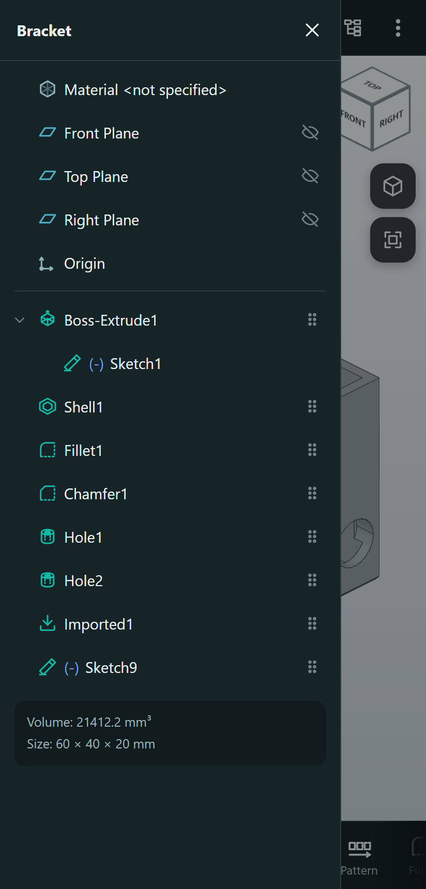
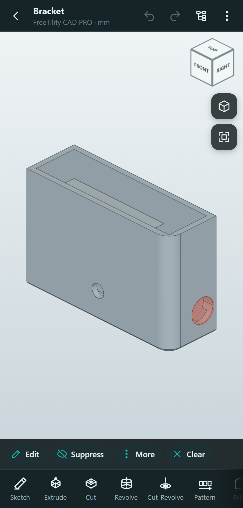
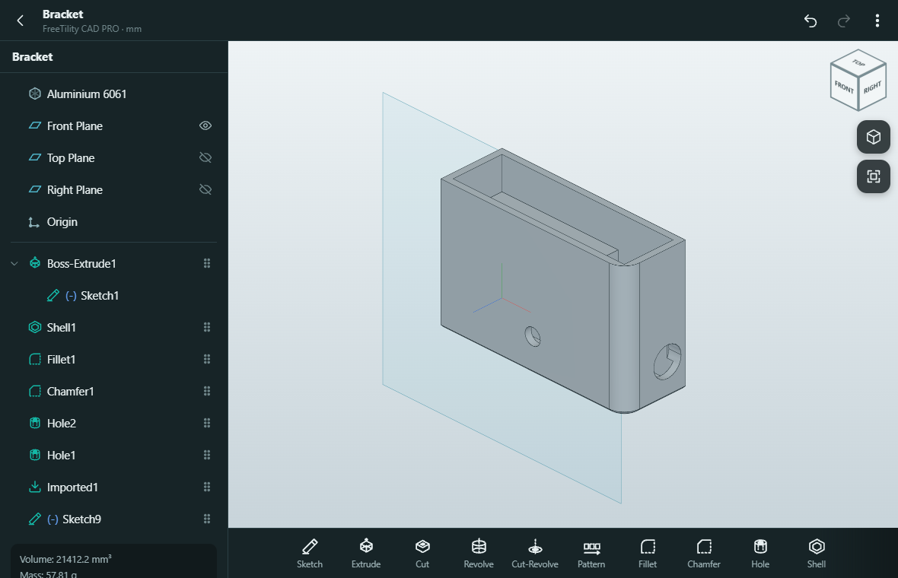
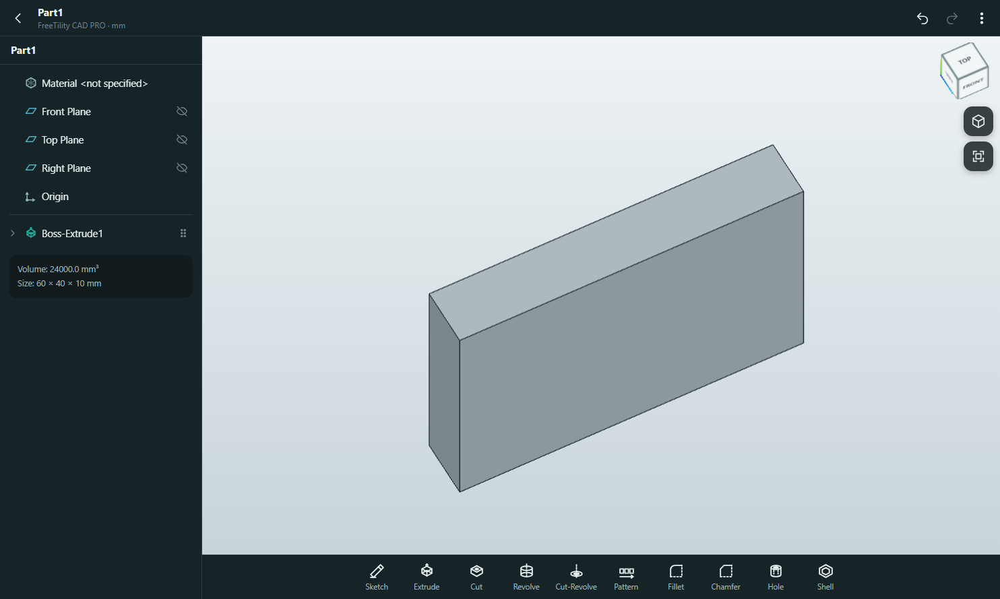

# FreeTility CAD and FreeTility CAD PRO

Free, offline, parametric 3D part modelling for Android and Windows, in the style of SolidWorks:
sketch, dimension, constrain, then extrude, revolve, cut, pattern and mirror, all from a feature tree you can edit later.

| App | Platforms | Geometry kernel | Adds |
|---|---|---|---|
| **FreeTility CAD** | Android | [Manifold](https://github.com/elalish/manifold) (mesh) | free, small (2.7 MB) |
| **FreeTility CAD PRO** | Android, Windows | [Open CASCADE](https://dev.opencascade.org/) via opencascade.js (exact B-rep) | fillet, chamfer, hole wizard, shell, STEP import / export |

**Download:** [latest release](https://github.com/SUKANTO550/freetility-cad/releases/latest)

- `FreeTilityCAD-<version>.apk`: Android, FreeTility CAD
- `FreeTilityCADPro-<version>.apk`: Android, FreeTility CAD PRO
- `FreeTilityCADProSetup-<version>.exe`: Windows 10 / 11, FreeTility CAD PRO (per-user install, no admin rights)

The APKs are debug-signed and the Windows installer is not code-signed, so Android asks you to allow the install and
Windows SmartScreen may warn ("More info" → "Run anyway").

<p>
  
  
  
  
</p>
<p>
  
  
</p>

## Features

**Sketching**
- Line, rectangle, circle, centre-point arc, centerline, trim, offset, and Convert Entities (copy model edges into the sketch).
- Relations: horizontal, vertical, parallel, perpendicular, equal, collinear, tangent, concentric, coincident, midpoint and fixed.
- Smart dimensions: length, distance (aligned, horizontal or vertical), diameter, radius and angle. You can type maths (`20+5`, `3/8in`), and a dimension that would over-define becomes a driven (reference) dimension.
- Own constraint solver, with SolidWorks colours: blue under defined, black fully defined, red over defined, plus a DOF count.
- Snapping to endpoints, midpoints, centres, curves, model corners, edge midpoints and edges (live-linked to the model), and the grid, with strength and per-type settings.

**Features**
- Extrude and revolve, boss or cut. Extrude ends are blind, mid plane, through all, or through all in both directions. You can pick which sketch regions to use.
- Linear pattern (1 or 2 directions), circular pattern, and mirror (features or the whole body).
- PRO adds fillet, chamfer, hole wizard (simple, counterbore, countersink, drill point), shell, and STEP import / export.
- Sketch on reference planes or on any flat face.

**Feature tree** (FeatureManager style)
- Top rows: material (gives mass), planes with show / hide, and origin.
- Sketches nest under the feature that uses them, with a `(-)` / `(+)` definition prefix.
- A tap shows a ghost of the feature's tool body. A double-tap edits the feature, and a long-press opens a menu (suspend, rename, parent / child, delete).
- Drag to reorder, with parent / child checks.

**Also:** undo / redo, a view cube and standard views, mm / inch, mass properties, and STL export for 3D printing. On Windows: SolidWorks-style mouse (middle-drag rotates), Ctrl+1…8 views, double-click `.ftcad` / `.step` files to open them, and drag and drop.

SolidWorks `.SLDPRT` files cannot be opened (closed format). Save them as STEP in SolidWorks and import the STEP into CAD PRO.

## Source layout

```
web/            shared UI (HTML, CSS, ES modules): sketcher, solver, feature model, 3D view (three.js)
cad/            Android app "FreeTility CAD": kernel.js on Manifold
cadpro/         Android app "FreeTility CAD PRO": kernel.js on OpenCascade
shared-java/    Android WebView host shared by both apps
WindowsApp/     Windows host for CAD PRO (C# WinForms, .NET Framework 4.8, WebView2) and its Inno Setup script
```

Only `kernel.js` differs between the two apps; both kernels expose the same functions.

## Building

**Android** (JDK 17+ and the Android SDK; create `local.properties` with `sdk.dir=...`):

```
./gradlew assembleDebug        # cad/build/... and cadpro/build/outputs/apk/debug/
```

**Windows** (.NET SDK, Inno Setup 6):

```
dotnet build WindowsApp/FreeTilityCADPro.csproj -c Release
ISCC WindowsApp/installer.iss
```

The web UI also runs in a desktop browser for development: serve the merged folders (`web/` plus `cad/src/main/assets` or `cadpro/src/main/assets`) at `/assets/` and open `/assets/index.html`. Parts are then kept in `localStorage`.

## Licence

MIT © 2026 Sukanto Biswas, see [LICENSE](LICENSE). Bundled libraries keep their own licences, see [THIRD_PARTY_NOTICES.md](THIRD_PARTY_NOTICES.md).

Created by Sukanto Biswas, Mechanical Engineer · © 2026 FreeTility
